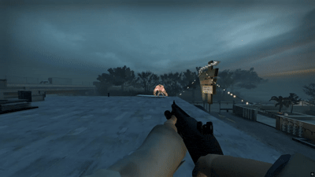
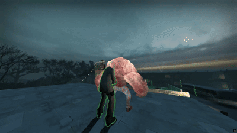
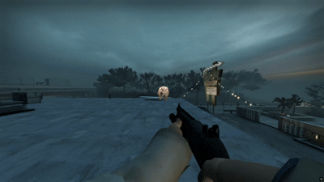
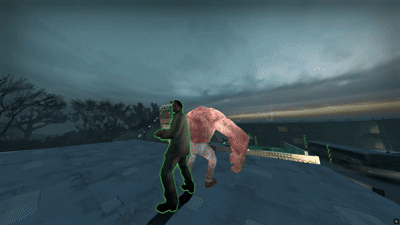

# Tank Rock Fix

* About:
  * Removes the 0.5-second window after a rock is thrown during which it cannot be destroyed.
  * Fixes a bug where a thrown rock could sometimes teleport to a Survivor near the Tank.

* Applicable to:
  * L4D1
  * L4D2

* Example:
  * Before:
  <br/>
  <br/>
  * After:
  <br/>
  <br/>

* ConVars:
  ```php
  // Fix Flags
  // 0 = Disable Plugin
  // 1 = Fix Rock Invulnerability
  // 2 = Fix Rock Teleport
  // 3 = Fix Rock Invulnerability & Teleport
  l4d_tankrock_fix_flags "3"

  // Tank Rock Fix Plugin Version
  l4d_tankrock_fix_version
  ```

* Installation:
  1. Put the l4d_tankrock_fix.smx in your servers \addons\sourcemod\plugins\ folder.
